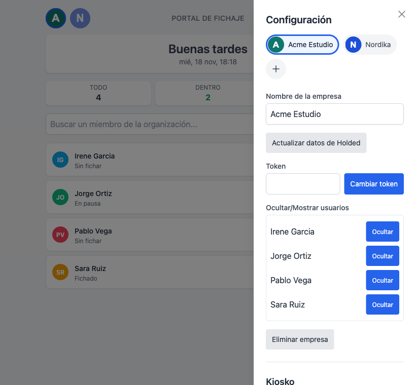
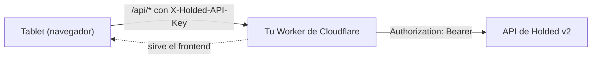

# Holded Kiosk

Un kiosko de fichaje para tablet que usa Holded: cada persona toca su nombre para fichar entrada, salida, pausa o reanudar.

[](https://deploy.workers.cloudflare.com/?url=https://github.com/rubengargar/holdedkiosk)


**In English.** Holded Kiosk is a self-hosted clock-in kiosk for [Holded](https://www.holded.com) (Spanish business software). Staff tap their name on a shared tablet to clock in, clock out, pause and resume. A Cloudflare Worker serves the Vue frontend and proxies Holded API v2. The deploy button clones the repository into your GitHub account and deploys the Worker on your Cloudflare account. The Worker stores nothing. The Holded API key lives in the tablet's `localStorage` in plain text, and there is no per-employee PIN. The sections on security and limits below apply in full. Documentation is in Spanish.

## Qué hace

*   Ficha entrada, salida, pausa y reanudación por empleado. Muestra el tiempo trabajado hoy.
*   Admite varias empresas de Holded en un mismo kiosko. Cada una tiene su lista de empleados, sus empleados ocultos y su logo.
*   Lista a los empleados con contrato vigente y sin fecha de baja. Puedes ocultar a quien no deba aparecer.
*   Toma el nombre y el logo de la empresa de Holded, si la clave tiene el permiso opcional.
*   Busca por nombre y resume cuántos hay en total, dentro y fuera.
*   Se adapta a pantallas táctiles, por ejemplo un iPad Mini.

## Despliegue en tres pasos

1.  **Pulsa el botón "Deploy to Cloudflare".** Clona este repositorio en tu GitHub y despliega un Worker en tu cuenta de Cloudflare. Nada pasa por la infraestructura del autor.
2.  **Crea una clave de API en Holded** con los permisos de la tabla.
3.  **Abre la URL del Worker en la tablet**, pulsa el engranaje y añade la empresa con esa clave. El kiosko la valida cargando la lista de empleados.

| Permiso | Obligatorio | Para qué |
| --- | --- | --- |
| `team:employees.read` | Sí | Listar empleados |
| `team:time-tracking.read` | Sí | Leer los fichajes del día |
| `team:time-tracking.write` | Sí | Fichar entrada, salida y pausas |
| `account:info.read` | No | Nombre y logo de la empresa. Sin él se muestran las iniciales |



Para añadir otra empresa, pulsa "+" en el selector del panel de configuración. El nombre es opcional: si lo dejas vacío, se usa el de Holded.


## Cómo funciona



El Worker sirve el frontend compilado y atiende `/api/*` desde el mismo origen, así que no hay CORS ni proyecto de Pages. La tablet envía la clave de la empresa activa en la cabecera `X-Holded-API-Key` y el Worker la reenvía a Holded como Bearer.

Holded permite 100 peticiones por minuto por clave. El kiosko se queda muy por debajo.

*   Cada 2 minutos hace una consulta de fichajes por empresa activa, y solo mientras la página está visible. Esa única petición devuelve los fichajes de todos los empleados.
*   La lista de empleados se pide al añadir la empresa, en la primera vista tras cargar la página, cuando tiene más de 15 minutos y con el botón "Actualizar". No se pide en cada consulta.
*   Cada acción de fichaje envía una petición y ninguna lectura posterior. La siguiente consulta concilia el estado.
*   Nombre y logo se piden al añadir la empresa, al cambiar su token, al sincronizar por primera vez una empresa que no los tiene y con "Actualizar datos de Holded". Nunca en las consultas periódicas.
*   Ante un 429, el kiosko muestra un aviso y mantiene los datos que ya tenía en pantalla.

## Seguridad y privacidad

**Qué hace el Worker.** Devuelve únicamente el `id` y el nombre de cada empleado, y el nombre y la URL del logo de la empresa. No devuelve IBAN, número de la Seguridad Social, salario ni dirección, aunque Holded los envíe a la API. El código del Worker no guarda datos ni escribe logs. Cloudflare, como plataforma, puede registrar peticiones según la configuración de tu cuenta.

**Límite de peticiones.** El Worker aplica unas 120 peticiones por minuto por IP en `/api/*` y responde 429 al superarlo. Es un límite aproximado, el de la función de rate limiting de Cloudflare.

**Cabeceras.** El frontend se sirve con una Content-Security-Policy restrictiva (`script-src 'self'`, `frame-ancestors 'none'`, imágenes de `self`, `data:` y cualquier origen `https:`, porque el logo puede venir de otro host y las imágenes no ejecutan código), `X-Frame-Options: DENY`, `X-Content-Type-Options: nosniff`, `Referrer-Policy: no-referrer` y una Permissions-Policy que desactiva cámara, micrófono y geolocalización. Esa política, la del archivo `_headers`, cubre el frontend. Las respuestas de `/api` llevan `X-Content-Type-Options: nosniff` y `Cache-Control: no-store`, que añade el Worker.

**Límites que debes conocer.**

*   La clave de API se guarda en el `localStorage` de la tablet, en texto plano y sin PIN. Cualquiera con acceso al navegador de la tablet puede leerla.
*   Con el permiso `team:employees.read`, esa clave puede leer los registros completos de los empleados directamente en la API de Holded, no solo los campos que muestra el kiosko. Usa una clave dedicada, solo con los permisos de la tabla, y un dispositivo que controles.
*   No hay PIN por empleado. Cualquiera que tenga delante el kiosko puede fichar por cualquier otra persona.
*   La URL del kiosko no tiene control de acceso. Quien la conozca puede abrirla y usar el Worker como pasarela con su propia clave de Holded, dentro del límite de peticiones.

## Desarrollo local

Con Node.js 22.12 o superior, en la raíz del repositorio:

```bash
npm install     # instala también frontend/ y worker/
npm run dev     # compila el frontend y arranca wrangler dev
```

Para trabajar sin cuenta de Holded, `worker/test/mock-holded.mjs` hace de Holded. El mock acepta cualquier clave que empiece por `key-`.

```bash
# terminal 1: Holded simulado en el puerto 8788
node worker/test/mock-holded.mjs 8788

# terminal 2: Worker en el puerto 8787, apuntando al mock
npx wrangler dev --var HOLDED_API_BASE:http://127.0.0.1:8788

# terminal 3: frontend en el puerto 5173, con /api redirigido al Worker
npm --prefix frontend run dev
```

Añade una empresa con un token como `key-demo`. Usa `key-otra` u otro valor que empiece por `key-` para una segunda empresa.

Comprobaciones, desde la raíz: `npm run typecheck`, `npm test` y `npm run build`.

## Configuración

| Ajuste | Dónde | Valor por defecto | Descripción |
| --- | --- | --- | --- |
| `ALLOWED_ORIGINS` | Variable del Worker | Sin definir | Orígenes separados por comas con acceso CORS a `/api/*`. Vacío, el Worker no concede acceso entre orígenes. Solo hace falta si el frontend se aloja en otro origen |
| `HOLDED_API_BASE` | Variable del Worker | `https://api.holded.com` | URL base de la API de Holded. Solo se cambia para apuntar al mock |
| `VITE_WORKER_BASE` | Variable de compilación del frontend | Vacío (mismo origen) | URL del Worker cuando el frontend se aloja aparte. Fija además el `connect-src` de la CSP a ese origen |
| `[[ratelimits]]` | `wrangler.toml` | `limit = 120`, `period = 60` | Peticiones permitidas por IP en el periodo, en segundos, con el binding `RATE_LIMITER` |

El `wrangler.toml` de la raíz es neutro: Worker `holded-kiosk`, sin `ALLOWED_ORIGINS`. Scripts de la raíz: `build`, `deploy`, `dev`, `test`, `typecheck`.

Para alojar el frontend en otro sitio, compílalo con `VITE_WORKER_BASE` apuntando al Worker, publica `frontend/dist` y añade ese origen a `ALLOWED_ORIGINS`.

## Despliegue del mantenedor

El kiosko de producción es un proyecto de Cloudflare Pages más el Worker `holded-proxy-worker`. La configuración del repositorio es neutra, así que producción aporta su nombre y sus orígenes al desplegar:

```bash
npx wrangler deploy --name holded-proxy-worker \
  --var "ALLOWED_ORIGINS:https://holdedkiosk.pages.dev,http://localhost:5173"
```

Ejecútalo después de `npm run build`. Con Workers Builds, el comando de compilación es `npm run build` y el comando de despliegue es la línea `npx wrangler deploy --name holded-proxy-worker --var "ALLOWED_ORIGINS:..."` de arriba, con tus orígenes. Un despliegue sin el paso de compilación falla, porque `frontend/dist` no está en git.

**Aviso.** Si Cloudflare abre un pull request automático que renombra el Worker en `wrangler.toml` a `holded-proxy-worker`, ciérralo sin fusionar. La configuración del repositorio debe seguir neutra para quien use el botón de despliegue.

Pages conserva su configuración: directorio raíz `frontend`, comando de compilación `npm run build`, salida `dist` y `VITE_WORKER_BASE` con la URL del Worker.

Despliegue desde un clon, sin el botón: `npm install`, `npx wrangler login` y `npm run deploy`.

## Limitaciones conocidas

*   El estado "en pausa" que devuelve Holded no está documentado en la especificación de la API v2, que solo lista `running` y `done`. El Worker asume que sigue siendo `paused`, como en la v1.
*   El binding de rate limiting no se ha confirmado en el plan Free de Cloudflare. Si un despliegue falla en el bloque `[[ratelimits]]`, borra ese bloque de `wrangler.toml`. El Worker funciona sin él, sin límite de peticiones.
*   El logo se sirve desde `app.holded.com` a partir de una ruta que devuelve Holded. Ese host se ha observado, no está documentado.
*   El Worker lee como máximo 5 páginas de 200 fichajes por consulta y 25 páginas de empleados. En una empresa muy grande, los fichajes más antiguos de la ventana consultada pueden quedar fuera.
*   Una jornada que empezó antes de medianoche cuenta en el total de hoy solo las horas desde las 00:00.
*   Mientras una sesión está en pausa, su tiempo sigue sumando al total de hoy.
*   Una acción de fichaje fallida muestra su error hasta la siguiente acción o hasta descartarlo, y refresca los tiempos de esa empresa una vez.

## Aviso y licencia

Proyecto independiente. No está afiliado a Holded ni cuenta con su respaldo. "Holded" es una marca de su titular.

MIT, consulta [LICENSE](LICENSE).
