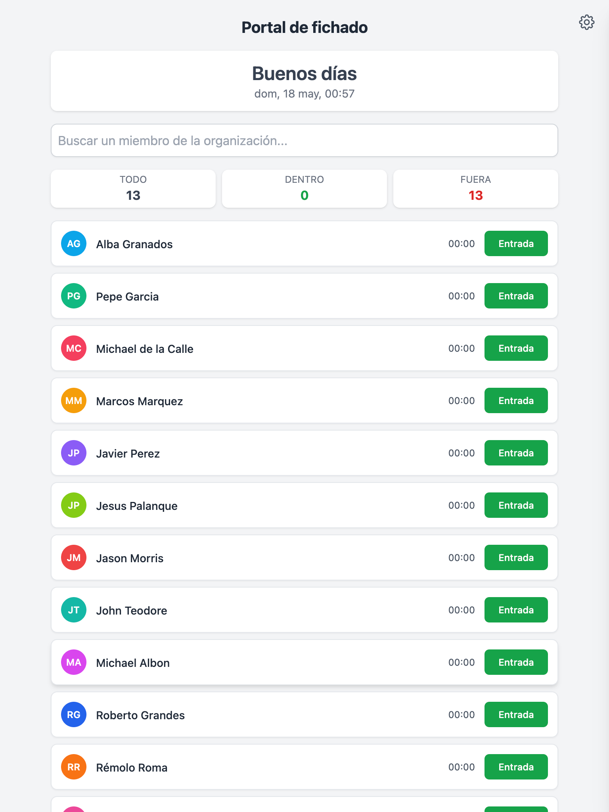

# Holded Kiosk

A kiosk for clocking employees in and out of Holded. Workers tap their name to clock in or out. A Vue 3 frontend talks to a Cloudflare Worker, which proxies the Holded API.

## Screenshot



## Security note

Holded API tokens are stored in the browser's `localStorage`, one per company, in plain text. There is no PIN or password protecting them, so anyone with access to the kiosk browser can read them. Use tokens with only the scopes listed below, and run the kiosk on a device you control.

The worker does not store tokens. The browser sends the token of the active company in the `X-Holded-API-Key` header on each request, and the worker forwards it to Holded as a Bearer token. The worker returns only employee id and name, never the other employee fields Holded stores (IBAN, social security number, salary, address).

## Features

*   Several Holded companies on one kiosk. With two or more companies, a row of tabs under the header switches between them. Each company keeps its own employee list, hidden employees and loaded data.
*   Lists employees with an active contract and no termination date.
*   Hide employees, per company.
*   Clock-in and clock-out per employee, with the time tracked today.
*   Search, colored avatars, and a Todo / Dentro / Fuera summary.
*   Responsive layout for touchscreens such as an iPad Mini.
*   Legacy single-token installs (`holded_token`, `hidden_employee_ids` in `localStorage`) migrate to one company automatically.

### Holded API usage

Holded allows 100 requests per minute per API key. The kiosk keeps well under that:

*   The employee list is fetched when a company is added (this also validates the token), on first view after page load, when it is older than 15 minutes at poll time, and on the "Actualizar" button. It is not fetched on every poll.
*   Times are fetched with one request that returns all employees' entries for the day. The kiosk polls every 2 minutes, only for the active company and only while the page is visible. Switching company or returning to the page refreshes only data older than 30 seconds.
*   Clocking in or out sends one request and no follow-up reads. The local state is updated from the result and the next poll reconciles it.
*   The tracked time shown on each row is computed in the browser once a minute.
*   On a 429 response the kiosk shows a message and keeps the data already on screen.

## Project structure

*   `frontend/`: Vue 3 + Vite + Tailwind app.
*   `worker/`: Cloudflare Worker that proxies the Holded API (v2).

## Prerequisites

*   [Node.js](https://nodejs.org/) 18 or later.
*   [Wrangler CLI](https://developers.cloudflare.com/workers/wrangler/get-started/) (`npm install -g wrangler`).
*   A Holded account with an API key. The worker uses Holded API v2 and sends the key as `Authorization: Bearer <key>`. The key needs these scopes:
    *   `team:employees.read`
    *   `team:time-tracking.read`
    *   `team:time-tracking.write`

## Setup and deployment

### 1. Deploy the worker

```bash
cd worker
wrangler login
wrangler deploy
```

Wrangler prints the worker URL, for example `https://holded-proxy-worker.your-subdomain.workers.dev`. The frontend needs it.

Set `ALLOWED_ORIGINS` in `worker/wrangler.toml` to the comma-separated list of origins that may call the worker. The worker answers CORS requests only for those origins. The default is `https://holdedkiosk.pages.dev,http://localhost:5173`. Add the origin where you host the frontend.

```toml
[vars]
ALLOWED_ORIGINS = "https://your-kiosk.pages.dev,http://localhost:5173"
```

To deploy from Cloudflare Workers Builds, connect the repository and use these settings from the repository root:

```text
Root directory: /
Build command: None
Deploy command: npx wrangler deploy
Version command: npx wrangler versions upload
Production branch: main
```

The root `wrangler.toml` points to `worker/src/index.ts`, so the deploy command works from the monorepo root.

### 2. Configure and build the frontend

```bash
cd frontend
npm install
cp .env.example .env
```

Set the worker URL in `frontend/.env`:

```bash
VITE_WORKER_BASE=https://holded-proxy-worker.your-subdomain.workers.dev
```

Build and deploy the `dist` folder to any static host. For Cloudflare Pages:

```bash
npm run build
wrangler pages deploy dist
```

## Local development against the mock

`worker/test/mock-holded.mjs` stands in for Holded, so you can develop without a real account. Any API key starting with `key-` is accepted by the mock.

```bash
# terminal 1: mock Holded on port 8788
node worker/test/mock-holded.mjs 8788

# terminal 2: worker on port 8787, pointed at the mock
cd worker
wrangler dev --var HOLDED_API_BASE:http://127.0.0.1:8788

# terminal 3: frontend on port 5173
cd frontend
cp .env.example .env   # VITE_WORKER_BASE=http://localhost:8787
npm run dev
```

Add a company in the kiosk with a token such as `key-demo`. Use `key-other` for a second company.

Frontend checks:

```bash
cd frontend
npm test
npx vue-tsc --noEmit
npm run build
```

## Usage

1. Open the kiosk URL.
2. On first run, enter a company name and its Holded API token. The kiosk validates the token by loading the employee list.
3. Tap "Entrada" or "Salida" next to a name.
4. Open the settings panel (gear icon) to rename or delete companies, add another company, hide employees of the active company, or change the kiosk title.

## License

MIT, see [LICENSE](LICENSE).
