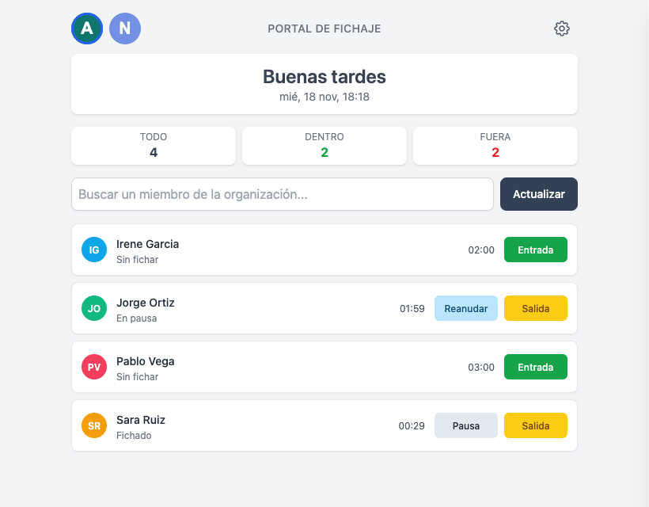
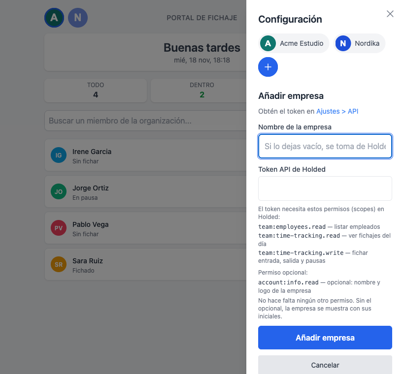
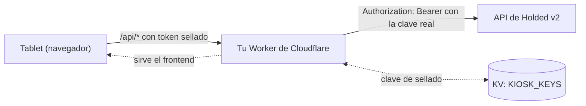

# Kiosk for Holded

Un kiosko de fichaje para tablet que usa Holded: cada persona toca su nombre para fichar entrada, salida, pausa o reanudar.

[](https://deploy.workers.cloudflare.com/?url=https://github.com/rubengargar/holdedkiosk)



**In English.** Kiosk for Holded is a self-hosted clock-in kiosk for [Holded](https://www.holded.com) (Spanish business software). Staff tap their name on a shared tablet to clock in, clock out, pause and resume. A Cloudflare Worker serves the Vue frontend and proxies Holded API v2. The deploy button clones the repository into your GitHub account and deploys the Worker on your Cloudflare account. The Worker seals each Holded API key with AES-256-GCM and, once it has reloaded this version, the tablet stores only the sealed token, which is useless against Holded directly but works through your Worker from anywhere. The sealing key lives in a KV namespace the deploy button creates for you. There is no per-employee PIN. The sections on security and limits below apply in full. Documentation is in Spanish.

## Qué hace

*   Ficha entrada, salida, pausa y reanudación por empleado. Muestra el tiempo trabajado hoy.
*   Admite varias empresas de Holded en un mismo kiosko. Cada una tiene su lista de empleados, sus empleados ocultos, su logo y su intervalo de refresco automático (15, 30 o 60 minutos, o solo manual) en Ajustes, con una estimación de las llamadas mensuales que implica.
*   Lista a los empleados con contrato vigente y sin fecha de baja. Puedes ocultar a quien no deba aparecer.
*   Toma el nombre y el logo de la empresa de Holded, si la clave tiene el permiso opcional.
*   Busca por nombre y resume cuántos hay en total, dentro y fuera.
*   Se adapta a pantallas táctiles, por ejemplo un iPad Mini.

## Despliegue en tres pasos

1.  **Pulsa el botón "Deploy to Cloudflare".** Clona este repositorio en tu GitHub y despliega un Worker en tu cuenta de Cloudflare. Nada pasa por la infraestructura del autor.
2.  **Crea una clave de API en Holded** con los permisos de la tabla.
3.  **Abre la URL del Worker en la tablet**, pulsa el engranaje y añade la empresa con esa clave. El kiosko la valida cargando la lista de empleados.

| Permiso | Obligatorio | Para qué |
| --- | --- | --- |
| `team:employees.read` | Sí | Listar empleados |
| `team:time-tracking.read` | Sí | Leer los fichajes del día |
| `team:time-tracking.write` | Sí | Fichar entrada, salida y pausas |
| `account:info.read` | No | Nombre y logo de la empresa. Sin él se muestran las iniciales |


Para añadir otra empresa, pulsa "+" en el selector del panel de configuración. El nombre es opcional: si lo dejas vacío, se usa el de Holded.



## Montar la tablet en la pared

El kiosko es una página web, así que sirve cualquier tablet barata con navegador, un soporte de pared y un cargador siempre enchufado.

**Android con [Fully Kiosk Browser](https://www.fully-kiosk.com/)**

1. Instala Fully Kiosk Browser desde Google Play o con su APK.
2. En `Web Content Settings`, pon la dirección de tu kiosko en `Start URL`.
3. Activa `Keep Screen On` para que la pantalla no se apague.
4. En `Web Auto Reload`, activa `Auto Reload on Network Reconnect` para que se recupere sola si cae el wifi.
5. En esa misma sección, deja desactivados `Delete Webstorage on Auto Reload` y `Delete Cookies on Auto Reload`. El kiosko guarda sus empresas en el almacenamiento del navegador, y borrarlo obliga a configurarlo de nuevo.
6. Si activaste la [contraseña del kiosko](#proteger-el-kiosko-con-contraseña), en `Web Content Settings` rellena `Username (optional)` con el usuario (`kiosk` por defecto) y `Password (optional)` con la contraseña. Fully Kiosk las usa como "user name" y "password for Basic HTTP Authentication" solo en los hosts de `Start URL`, cuando el servidor pide autenticación.
7. Activa `Kiosk Mode` con un PIN para que nadie salga del navegador ni abra otras aplicaciones.

Fully Kiosk se puede probar gratis con todas sus funciones. El modo kiosko requiere la licencia PLUS: 8,90 € más impuestos por dispositivo, pago único. Su fabricante desaconseja las tablets Amazon Fire para uso permanente.

**iPad**

No hace falta ninguna aplicación. Abre el kiosko en Safari y bloquéalo con Acceso guiado, que está en Ajustes, Accesibilidad.

## Cómo funciona



El Worker sirve el frontend compilado y atiende `/api/*` desde el mismo origen, así que no hay CORS ni proyecto de Pages. Al añadir una empresa, la tablet envía la clave de Holded una sola vez a `POST /api/seal`. El Worker la valida con la misma petición de empleados de siempre, la cifra con AES-256-GCM y devuelve un token sellado (`sealed.v1.<kid>.<iv>.<cifrado>`). La tablet guarda solo ese token y lo envía en la cabecera `X-Holded-API-Key`. El Worker lo descifra y reenvía la clave real a Holded como Bearer. Por compatibilidad, el Worker sigue aceptando también una clave sin sellar.

### Cuota de llamadas de Holded

Además del límite por minuto, Holded fija una cuota **mensual** de llamadas por cuenta, compartida por todas las claves de API de esa cuenta ([fuente](https://www.holded.com/developers/rate-limiting)). Los planes inferiores devuelven 429 cuando se agota.

| Plan | Peticiones por minuto | Llamadas al mes |
| --- | --- | --- |
| Starter | 60 | 500 |
| Growth, Basic | 60 | 2.000 |
| Standard | 120 | 7.500 |
| Advanced | 120 | 30.000 |
| Premium | 600 | 100.000, y después se factura el exceso |

Fichar desde la app de Holded no consume cuota de API. Solo cuentan las llamadas que hace el kiosko, y también las de cualquier otra integración de la misma cuenta de Holded.

**Qué gasta el kiosko.** Cada acción de fichaje es una llamada, sin lectura posterior. Las lecturas en segundo plano son escasas a propósito:

*   Los fichajes de todos los empleados de la empresa activa son una sola llamada por lectura, siempre que los fichajes del día quepan en una página de 200 y Holded los devuelva del más nuevo al más antiguo (lo hemos observado, Holded no lo documenta). Si no, una lectura puede costar hasta 5 llamadas. Se refrescan cada 30 minutos por defecto, y solo mientras la página está visible y alguien la ha tocado en las últimas 2 horas. Sin interacción durante 2 horas (noches, fines de semana) el kiosko no hace ninguna llamada. La primera pulsación después de ese parón refresca si los datos tienen más antigüedad que el intervalo de la empresa.
*   La lista de empleados se refresca como mucho una vez cada 24 horas, además de al añadir la empresa, al cambiar su token y con el botón "Actualizar". Nunca en cada consulta.
*   Al recargar la página (Fully Kiosk la recarga al volver la red) el kiosko reutiliza los empleados y fichajes guardados en el navegador, en la clave `kiosk_state` (sin tokens), y solo llama si esos datos han caducado.
*   Cambiar de empresa o volver a mostrar la página solo refresca si los datos son más antiguos que el intervalo de la empresa.
*   El cambio de día no necesita ninguna llamada: los totales se calculan en local desde las 00:00.
*   Sellar la clave no añade llamadas: la lista de empleados viene en la respuesta de `/api/seal`. Una tablet con claves sin sellar las sella una vez al cargar la página y reintenta en la siguiente carga si falla.
*   Nombre y logo se piden al añadir la empresa, al cambiar su token, al sincronizar por primera vez una empresa que no los tiene y con "Actualizar datos de Holded".
*   Una acción de fichaje fallida refresca los fichajes de esa empresa una vez, salvo que la cuota esté agotada.
*   Una lectura fallida (error de Holded o del Worker, token o contraseña rechazados, sin red) no se reintenta en cada minuto ni al recargar la página: esa empresa espera su intervalo de refresco (30 minutos en "Solo manual") antes de volver a leer, así que una clave rota cuesta lo mismo que una sana. "Actualizar" ignora la espera y una lectura correcta la borra. La espera y el bloqueo de cuota se guardan en `kiosk_state`, y se descartan si ya han pasado o si quedan a más de 32 días (la cuota) o 24 horas (la espera).
*   Junto al botón "Actualizar" el kiosko indica la antigüedad de los datos ("Actualizado hace 12 min"), porque con lecturas escasas una fila puede seguir en "Fichado" aunque alguien haya fichado la salida desde el móvil. Se actualiza con el reloj de cada minuto, sin llamadas.

**Fórmula.** Llamadas al mes = días laborables x (acciones de fichaje por empleado y día x empleados + refrescos en segundo plano al día + 1 de la lista de empleados). El kiosko sigue refrescando durante las 2 horas siguientes a la última pulsación, así que con 10 horas de pulsaciones al día lee durante 12 horas. Con 22 días laborables y 4 acciones por empleado y día (entrada, pausa, reanudar y salida), cada empleado gasta 88 llamadas al mes. El segundo plano gasta, en llamadas al mes:

| Refresco | Lecturas de fichajes (22 x lecturas al día) | Más 22 de la lista de empleados |
| --- | --- | --- |
| Cada 15 min | 1.056 (22 x 48) | 1.078 |
| Cada 30 min | 528 (22 x 24) | 550 |
| Cada 60 min | 264 (22 x 12) | 286 |
| Solo manual | 0 | 22 |

Empleados que caben en cada plan, con esos supuestos (se redondea hacia abajo):

| Plan | Llamadas al mes | Cada 15 min | Cada 30 min | Cada 60 min | Solo manual |
| --- | --- | --- | --- | --- | --- |
| Starter | 500 | 0 | 0 | 2 | 5 |
| Growth, Basic | 2.000 | 10 | 16 | 19 | 22 |
| Standard | 7.500 | 72 | 78 | 81 | 84 |
| Advanced | 30.000 | 328 | 334 | 337 | 340 |
| Premium | 100.000 | 1.124 | 1.130 | 1.133 | 1.136 |

Las cifras son por tablet: dos tablets con la misma cuenta de Holded duplican el coste del segundo plano, y las de cualquier otra integración se suman. Es una estimación: cada refresco manual, cada primera pulsación tras un parón y cada recarga con datos caducados suman llamadas. En Starter elige "Solo manual" en Ajustes: con refresco cada 30 minutos el segundo plano ya consume toda la cuota.

**Cuando se agota.** El Worker devuelve al kiosko las cabeceras `X-RateLimit-Window`, `X-RateLimit-Remaining`, `X-RateLimit-Reset` y `Retry-After` de un 429 de Holded. Si la ventana es `month`, el kiosko deja de refrescar en segundo plano esa empresa hasta la hora de reinicio (o hasta el mes siguiente si no hay cabecera o `X-RateLimit-Reset` no son segundos epoch dentro de los próximos 32 días), también tras recargar la página, ya que el bloqueo se guarda en `kiosk_state` y muestra un aviso permanente: fichar desde el kiosko fallará hasta que se restablezca la cuota o se amplíe el plan, y mientras tanto se puede fichar desde la app de Holded. "Actualizar" sigue intentándolo una vez. Las acciones de fichaje se siguen enviando, y cualquier llamada correcta de esa empresa, un fichaje incluido, borra el bloqueo y el aviso. Si la ventana es `minute`, el kiosko muestra el aviso temporal y espera `Retry-After` segundos antes de volver a leer. Un 429 de Holded sin cabecera `X-RateLimit-Window` se trata igual la primera vez, pero si se repite en el siguiente intento la empresa espera su intervalo de refresco, como con cualquier otro error: con una clave que falla siempre son como mucho 5 lecturas de fichajes en 2 horas de uso.

**Páginas del Worker.** Holded devuelve los fichajes y los empleados por páginas de 200, y cada página es una llamada. El Worker no pide una segunda página cuando la primera ya responde: los fichajes se detienen en cuanto una página ordenada de más nuevo a más antiguo llega a antes del inicio de hoy (o viene vacía), y los empleados cuando `has_more` es falso. Una empresa de hasta 200 empleados cuesta una llamada por lectura de empleados. Con los fichajes, "una llamada por lectura" vale mientras los del día quepan en una página de 200 y Holded devuelva el más nuevo primero, que se ha observado pero no está documentado. Si no, una lectura puede costar hasta 5 llamadas.

## Proteger el kiosko con contraseña

Opcional y desactivada por defecto. Con ella, el Worker pide autenticación HTTP Basic en todas las peticiones, tanto la página y sus archivos como `/api/*`. Sin credenciales válidas responde 401. Si no la defines, el kiosko funciona exactamente como antes.

Para activarla, define el secreto `KIOSK_PASSWORD`. Un valor vacío o ausente la deja desactivada.

La contraseña debe tener al menos 16 caracteres y ser aleatoria. Genera una con `openssl rand -base64 24`. El Worker recorta los espacios y saltos de línea de los extremos antes de usarla, así que un salto de línea pegado al final del secreto no forma parte de la contraseña (en Fully Kiosk escribe la contraseña sin él). Un valor vacío o solo de espacios la deja desactivada. Si defines una contraseña de menos de 16 caracteres tras recortarla, el Worker falla cerrado: toda petición, salvo el preflight `OPTIONS`, recibe un 500 con `KIOSK_PASSWORD must be at least 16 characters` y no se sirve nada.

```bash
npx wrangler secret put KIOSK_PASSWORD
```

También puedes crearlo en el panel de Cloudflare, en Worker, Settings, Variables and Secrets. Opcionalmente, define la variable `KIOSK_USER` para cambiar el usuario, que por defecto es `kiosk`. En local, ponlos en un archivo `.dev.vars` (copia `.dev.vars.example`; está en `.gitignore`). `wrangler dev` lee `.dev.vars` al arrancar, así que reinícialo tras cambiarlo.

Después, introduce el usuario y la contraseña en Fully Kiosk (ver [Montar la tablet en la pared](#montar-la-tablet-en-la-pared)). En un navegador normal, el navegador pide las credenciales al abrir el kiosko y las reenvía en las llamadas a `/api/*`.

Qué protege. Impide que use el Worker quien solo conoce la URL o ha copiado un token sellado: sin la contraseña no se sirve la página ni se llama a Holded. El Worker responde 429 a quien supere el límite de peticiones por IP antes de mirar las credenciales, y compara usuario y contraseña en tiempo constante.

Qué no protege. Las credenciales quedan guardadas en el navegador kiosko de la tablet, así que quien controle del todo la tablet puede extraerlas. No es un PIN por empleado. Basic permite adivinar la contraseña por internet y la única protección real es la fuerza de la contraseña. El límite por IP solo frena a un cliente descuidado: es aproximado, por ubicación, cuenta por IP completa (un rango IPv6 /64 da claves ilimitadas) y falla abierto. Sin el binding `RATE_LIMITER` no hay ningún límite.

Solo para la instalación de un único Worker. Con el frontend en Cloudflare Pages y el Worker aparte (`ALLOWED_ORIGINS`), la contraseña del Worker no protege la página y las llamadas entre orígenes no llevan las credenciales: no lo combines. Si lo haces, el kiosko mostrará el aviso de contraseña del kiosko.

Como el Worker se ejecuta para cada petición, los archivos del frontend también cuentan como peticiones del Worker y entran en las 100.000 diarias del plan gratuito.

## Seguridad y privacidad

**Qué hace el Worker.** Sella las claves de Holded y devuelve únicamente el `id` y el nombre de cada empleado, y el nombre y la URL del logo de la empresa. No devuelve IBAN, número de la Seguridad Social, salario ni dirección, aunque Holded los envíe a la API. Lo único que guarda son las claves de sellado, en KV. No guarda claves de Holded ni escribe logs. Cloudflare, como plataforma, puede registrar peticiones según la configuración de tu cuenta.

**Claves selladas.** Una tablet que ya ha cargado esta versión no guarda la clave de Holded (las que la guardaban en claro se tratan en [Actualizar una instalación existente](#actualizar-una-instalación-existente)). El Worker la cifra con AES-256-GCM, con un IV aleatorio por sellado y el texto `holded-kiosk/v1` como datos adicionales autenticados, y la tablet guarda el resultado en `localStorage`. Cada clave de sellado de 256 bits la genera el Worker la primera vez que hace falta, con un identificador aleatorio (`kid`), y la guarda en el KV `KIOSK_KEYS` como `sealing-key:<kid>`. Nunca se sobrescribe una clave guardada. Un puntero, `sealing-key-current`, indica qué `kid` usar al sellar, y cada token lleva el suyo. Un token sellado que no se puede descifrar (manipulado, de un `kid` que existe pero con otra clave, o con la clave de sellado perdida) recibe un 401 y el kiosko pide volver a introducir la clave de Holded. Un `kid` que todavía no se encuentra en KV (la propagación puede tardar cerca de un minuto) recibe un 503 y el kiosko avisa de que es temporal, sin pedir la clave.

Qué arregla esto: copiar el token de la tablet ya no da acceso directo a Holded. Con `team:employees.read`, antes se podían leer IBAN, número de la Seguridad Social y salario de cada empleado. Ahora, desde la tablet, solo se alcanza lo que el Worker expone: `id` y nombre de los empleados, nombre y logo de la empresa y las acciones de fichaje. El sellado no deshace lo ya ocurrido: una clave que estuvo en claro en la tablet sigue comprometida hasta que se revoca.

**Límite de peticiones.** El Worker aplica unas 120 peticiones por minuto por IP en `/api/*`, y en toda la página si activas la contraseña del kiosko, y responde 429 al superarlo. Es un límite aproximado, el de la función de rate limiting de Cloudflare. No sustituye a una contraseña fuerte.

**Cabeceras.** El frontend se sirve con una Content-Security-Policy restrictiva (`script-src 'self'`, `frame-ancestors 'none'`, imágenes de `self`, `data:` y cualquier origen `https:`, porque el logo puede venir de otro host y las imágenes no ejecutan código), `X-Frame-Options: DENY`, `X-Content-Type-Options: nosniff`, `Referrer-Policy: no-referrer` y una Permissions-Policy que desactiva cámara, micrófono y geolocalización. Esa política, la del archivo `_headers`, cubre el frontend. Las respuestas de `/api` llevan `X-Content-Type-Options: nosniff` y `Cache-Control: no-store`, que añade el Worker.

**Límites que debes conocer.**

*   Quien tenga el token sellado puede usar tu Worker desde cualquier sitio, no solo desde la tablet: ver los nombres de los empleados y fichar entradas y salidas, dentro del límite de peticiones. El token sellado no caduca. Para invalidarlos todos a propósito (por ejemplo, si se pierde una tablet), borra del KV `KIOSK_KEYS` todas las entradas `sealing-key:*` y la entrada `sealing-key-current`, espera un minuto a que se propague el borrado y vuelve a introducir las claves de Holded en cada tablet. Un Worker que ya tenga una clave en memoria la sigue aceptando hasta que se reinicie, así que no cuentes con que corte el acceso al instante. Revoca además la clave de Holded: es lo único que corta el acceso de verdad, también para una clave concreta.
*   La clave de Holded está en claro mientras se escribe y viaja en claro dentro de TLS hasta el Worker. Una tablet con una versión anterior del kiosko la sigue guardando sin sellar hasta que carga esta versión y el sellado funciona, y entonces la clave en claro desaparece de la tablet pero no queda invalidada.
*   Quien opera el Worker y su KV puede leer las claves: puede descifrar cualquier token con la clave de sellado y ve las claves en memoria al procesar cada petición.
*   KV no ofrece "escribir si no existe" y es eventualmente consistente. Por eso cada clave de sellado se guarda con su propio `kid` y nunca se sobrescribe: si dos regiones sellan por primera vez a la vez, cada una usa su clave y todas siguen siendo legibles. Como mucho, en el primer minuto tras el primerísimo sellado, una petición puede recibir un "inténtalo de nuevo en un minuto" hasta que la clave se propaga.
*   No hay PIN por empleado. Cualquiera que tenga delante el kiosko puede fichar por cualquier otra persona.
*   Sin la [contraseña del kiosko](#proteger-el-kiosko-con-contraseña), la URL del kiosko no tiene control de acceso: quien la conozca puede abrirla y usar el Worker como pasarela con su propia clave de Holded, dentro del límite de peticiones. Con ella, la tablet guarda las credenciales y quien controle la tablet puede extraerlas.
*   Usa una clave dedicada, solo con los permisos de la tabla.

## Actualizar una instalación existente

El sellado no puede deshacer que una clave haya estado en claro en la tablet. Tras actualizar:

1.  Recarga cada tablet. Una tablet que no se ha recargado desde la actualización sigue guardando la clave en claro.
2.  Revoca cada clave de API en Holded y entra una nueva en el kiosko, con "Cambiar token". La clave antigua pudo copiarse mientras estaba en claro.

## Volver a una versión anterior

No vuelvas nunca el Worker a una versión anterior al sellado cuando las tablets ya han sellado sus claves. Ese Worker reenvía la cadena sellada a Holded, todas las empresas fallan y las claves en claro ya no están en las tablets. Corrige hacia delante. El KV conserva las claves de sellado, así que volver a desplegar esta versión restablece el servicio. Volver atrás el frontend de Pages es inofensivo.

## Desarrollo local

Con Node.js 22.12 o superior, en la raíz del repositorio:

```bash
npm install     # instala también frontend/ y worker/
npm run dev     # compila el frontend y arranca wrangler dev
```

Para trabajar sin cuenta de Holded, `worker/test/mock-holded.mjs` hace de Holded. El mock acepta cualquier clave que empiece por `key-`.

```bash
# terminal 1: Holded simulado en el puerto 8788
node worker/test/mock-holded.mjs 8788

# terminal 2: Worker en el puerto 8787, apuntando al mock
npx wrangler dev --var HOLDED_API_BASE:http://127.0.0.1:8788

# terminal 3: frontend en el puerto 5173, con /api redirigido al Worker
npm --prefix frontend run dev
```

Añade una empresa con un token como `key-demo`. Usa `key-otra` u otro valor que empiece por `key-` para una segunda empresa.

Comprobaciones, desde la raíz: `npm run typecheck`, `npm test` y `npm run build`.

## Configuración

| Ajuste | Dónde | Valor por defecto | Descripción |
| --- | --- | --- | --- |
| `ALLOWED_ORIGINS` | Variable del Worker | Sin definir | Orígenes separados por comas con acceso CORS a `/api/*`. Vacío, el Worker no concede acceso entre orígenes. Solo hace falta si el frontend se aloja en otro origen |
| `HOLDED_API_BASE` | Variable del Worker | `https://api.holded.com` | URL base de la API de Holded. Solo se cambia para apuntar al mock |
| `VITE_WORKER_BASE` | Variable de compilación del frontend | Vacío (mismo origen) | URL del Worker cuando el frontend se aloja aparte. Fija además el `connect-src` de la CSP a ese origen |
| `KIOSK_KEYS` | Binding KV en `wrangler.toml` | Se crea al desplegar | Namespace donde el Worker guarda la clave de sellado. Se declara sin `id`: el botón de despliegue y `wrangler deploy` lo crean y los despliegues siguientes lo reutilizan. Sin él, `/api/seal` responde 503: las empresas con claves sin sellar siguen funcionando, pero no se pueden añadir empresas ni cambiar tokens. En `wrangler dev` y en los tests es un KV local |
| `KIOSK_PASSWORD` | Secreto del Worker (`npx wrangler secret put KIOSK_PASSWORD`) o `.dev.vars` | Sin definir | Activa la autenticación HTTP Basic en todo el kiosko. Mínimo 16 caracteres tras recortar espacios (`openssl rand -base64 24`); si es más corta, el Worker responde 500 a todo. Vacío, solo espacios o ausente, está desactivada. Solo para la instalación de un único Worker |
| `KIOSK_USER` | Variable del Worker | `kiosk` | Usuario que acepta la autenticación cuando `KIOSK_PASSWORD` está definida |
| `[[ratelimits]]` | `wrangler.toml` | `limit = 120`, `period = 60` | Peticiones permitidas por IP en el periodo, en segundos, con el binding `RATE_LIMITER` |

El `wrangler.toml` de la raíz es neutro: Worker `kiosk-for-holded`, sin `ALLOWED_ORIGINS`. Scripts de la raíz: `build`, `deploy`, `dev`, `test`, `typecheck`.

Para alojar el frontend en otro sitio, compílalo con `VITE_WORKER_BASE` apuntando al Worker, publica `frontend/dist` y añade ese origen a `ALLOWED_ORIGINS`.

## Despliegue del mantenedor

El kiosko de producción es un proyecto de Cloudflare Pages más el Worker `holded-proxy-worker`. La configuración del repositorio es neutra, así que producción aporta su nombre y sus orígenes al desplegar:

```bash
npx wrangler deploy --name holded-proxy-worker \
  --var "ALLOWED_ORIGINS:https://holdedkiosk.pages.dev,http://localhost:5173"
```

Ejecútalo después de `npm run build`.

**Una vez, para el Worker que ya existe.** El primer despliegue con esta versión crea el namespace KV `holded-proxy-worker-kiosk-keys` y lo enlaza como `KIOSK_KEYS`. No hay que crear nada a mano ni cambiar el comando. El token de API que use el despliegue necesita el permiso Workers KV Storage (edit), que incluye el token por defecto de Workers Builds. Las tablets sellan sus claves guardadas en su siguiente carga.

**Orden del despliegue.** Pages se despliega solo al hacer push a `main`. Despliega el Worker desde la rama antes de fusionar, y fusiona después:

```bash
npm run build
npx wrangler deploy --name holded-proxy-worker \
  --var "ALLOWED_ORIGINS:https://holdedkiosk.pages.dev,http://localhost:5173"
```

Si se hace al revés, en el hueco los kioscos existentes siguen funcionando con claves en claro, pero añadir una empresa o cambiar un token falla hasta que el Worker tenga `/api/seal`. No borres el namespace: invalidaría todos los tokens sellados.

 Con Workers Builds, el comando de compilación es `npm run build` y el comando de despliegue es la línea `npx wrangler deploy --name holded-proxy-worker --var "ALLOWED_ORIGINS:..."` de arriba, con tus orígenes. Un despliegue sin el paso de compilación falla, porque `frontend/dist` no está en git.

**Aviso.** Si Cloudflare abre un pull request automático que renombra el Worker en `wrangler.toml` a `holded-proxy-worker`, ciérralo sin fusionar. La configuración del repositorio debe seguir neutra para quien use el botón de despliegue.

Pages conserva su configuración: directorio raíz `frontend`, comando de compilación `npm run build`, salida `dist` y `VITE_WORKER_BASE` con la URL del Worker.

Despliegue desde un clon, sin el botón: `npm install`, `npx wrangler login` y `npm run deploy`.

## Limitaciones conocidas

*   El estado "en pausa" que devuelve Holded no está documentado en la especificación de la API v2, que solo lista `running` y `done`. El Worker asume que sigue siendo `paused`, como en la v1.
*   La creación automática del KV con `wrangler deploy` y con el botón de despliegue se ha comprobado en la documentación de Cloudflare y en el código de Wrangler 4.164, no contra una cuenta real. Si el despliegue falla en `[[kv_namespaces]]`, crea el namespace con `npx wrangler kv namespace create KIOSK_KEYS` y pon su `id` en `wrangler.toml`. No borres el bloque: sin `KIOSK_KEYS`, las empresas con claves sin sellar siguen funcionando, pero no se pueden añadir empresas ni cambiar tokens, y los tokens ya sellados dejan de funcionar.
*   El binding de rate limiting no se ha confirmado en el plan Free de Cloudflare. Si un despliegue falla en el bloque `[[ratelimits]]`, borra ese bloque de `wrangler.toml`. El Worker funciona sin él, sin límite de peticiones.
*   El logo se sirve desde `app.holded.com` a partir de una ruta que devuelve Holded. Ese host se ha observado, no está documentado.
*   El Worker lee como máximo 5 páginas de 200 fichajes por consulta y 25 páginas de empleados, y cada página es una llamada que cuenta para la cuota mensual de Holded. En una empresa muy grande, los fichajes más antiguos de la ventana consultada pueden quedar fuera.
*   La cuota mensual de Holded es compartida con otras integraciones de la cuenta y, al agotarse, fichar desde el kiosko falla hasta el reinicio. El kiosko no ve la cuota restante: lo detecta al recibir el 429. Los empleados que caben por plan son una estimación con supuestos fijos (22 días, 10 horas de pulsaciones y 2 de lectura posterior, 4 fichajes por empleado y día, una sola tablet).
*   El kiosko solo refresca en segundo plano la empresa activa. Con varias empresas, las demás se actualizan al seleccionarlas si sus datos han caducado.
*   Una jornada que empezó antes de medianoche cuenta en el total de hoy solo las horas desde las 00:00.
*   Mientras una sesión está en pausa, su tiempo sigue sumando al total de hoy.
*   Una acción de fichaje fallida muestra su error hasta la siguiente acción o hasta descartarlo, y refresca los tiempos de esa empresa una vez, salvo que la cuota mensual esté agotada.

## Aviso y licencia

Proyecto independiente. No está afiliado a Holded ni cuenta con su respaldo. "Holded" es una marca de su titular.

MIT, consulta [LICENSE](LICENSE).
